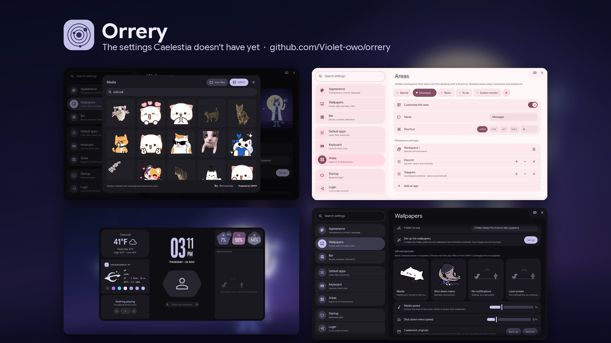
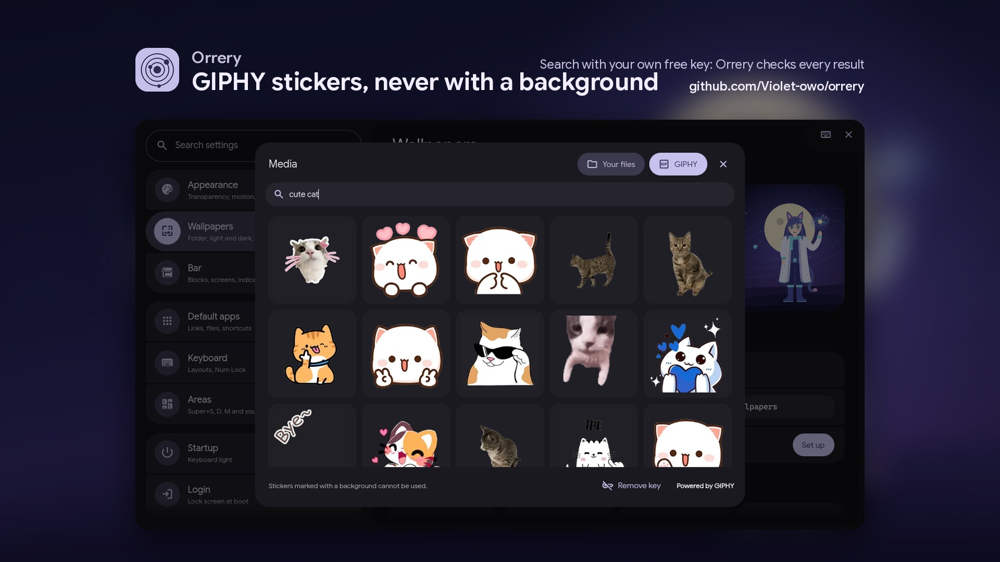
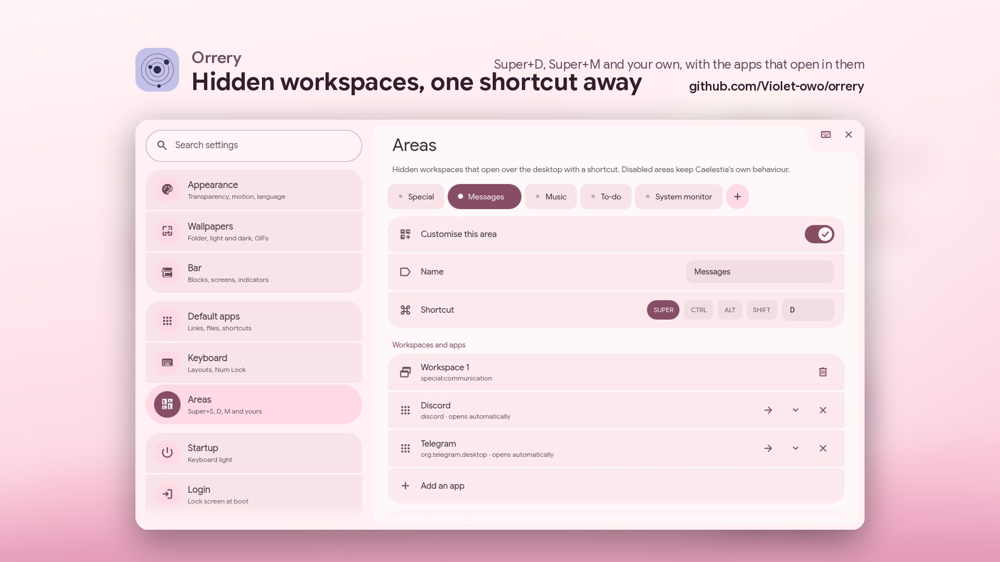
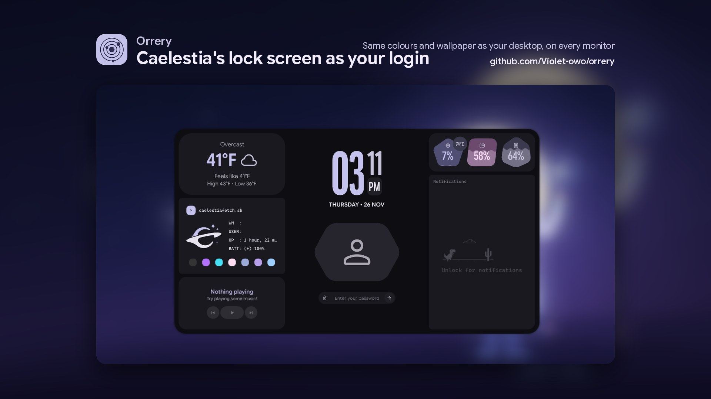
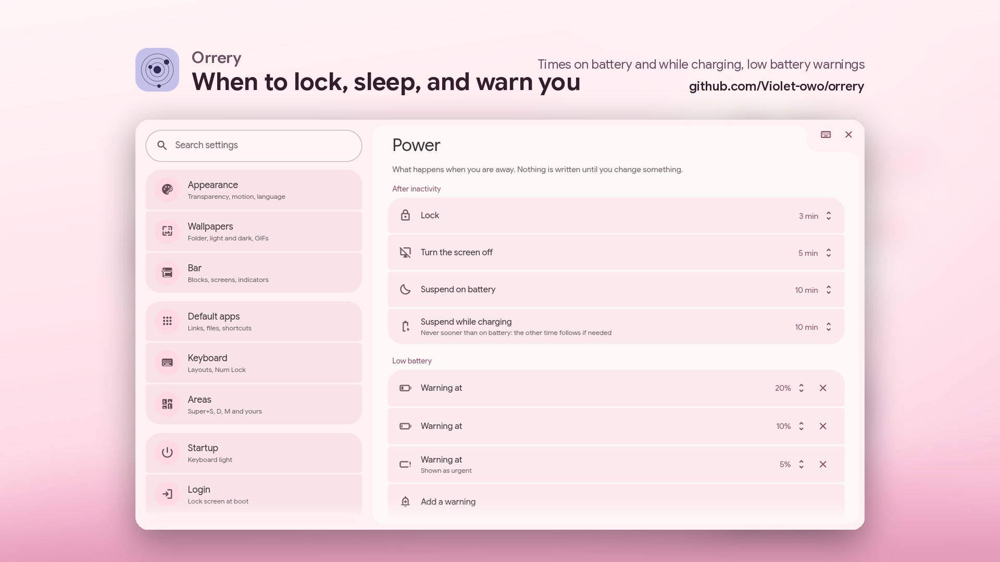

<div align="center">


# Orrery

**The settings Caelestia doesn't have yet.**

Areas, keyboard, default apps, wallpapers, power and login for the [Caelestia](https://github.com/caelestia-dots) desktop on Hyprland,
in an app that looks and moves like the shell itself.

By [Violet Miller](https://portfolio.violetvrc30.workers.dev/)

[Install](#install) · [What it does](#what-it-does) · [Keyboard](#keyboard) · [How it stays safe](#how-it-stays-safe) · [Italiano](#italiano)



 
 

</div>

> [!NOTE]
> Unofficial: Orrery is not made or endorsed by the Caelestia project.
> Early release, tested on one machine (CachyOS, Hyprland 0.57, Caelestia 2.5). Reports are welcome.

## What it does

| | |
|---|---|
| **Areas** | Every hidden workspace (`Super+S`, `D`, `M`, `R`, `Ctrl+Shift+Esc`, and your own): shortcut, apps, several workspaces per area, arrow navigation, side by side, animations. Areas you leave off keep Caelestia's behaviour. |
| **Keyboard** | Up to four layouts with variants, a shortcut to switch, Num Lock at startup, key repeat. |
| **Default apps** | Browser, terminal, editor, files, media, mail. Links, files *and* Caelestia's own shortcuts. |
| **Wallpapers** | Creates the folder, points Caelestia at it and makes it show up **without a restart**. Two wallpapers included, light and dark. GIFs for media and the shut down menu, from your files or GIPHY (with your own free key), always without background. |
| **Startup** | Keyboard backlight at boot. |
| **Login** | Caelestia's lock screen as your greetd login, following your colours and wallpaper. *Experimental.* |
| **Appearance** | Follows Caelestia's palette live, plus transparency, motion, rounding and language. |
| **Bar** | Order of the bar's blocks, which screens show it, and the volume and brightness indicators. |
| **Power** | When to lock, turn the screen off and suspend, on battery and while charging; low battery warnings. |
| **Health** | Checks for the usual breakages, undo, and an off switch. |

English and Italian. Fully usable without a mouse.

## Install

Orrery needs [Caelestia](https://github.com/caelestia-dots/caelestia) (shell and dotfiles, Lua configuration) on Hyprland 0.55 or newer.

```sh
mkdir orrery && cd orrery
curl -LO https://github.com/Violet-owo/orrery/releases/latest/download/PKGBUILD
paru -Bi .                    # or: makepkg -si
```

Not on the AUR yet. Update by running the same commands again; remove with `sudo pacman -Rns orrery-caelestia`
(first turn it off in *Health*, and remove what you enabled in *Startup* and *Login*).

### Channels

| Channel | Branch | Get it |
|---|---|---|
| **Stable** | [`main`](https://github.com/Violet-owo/orrery/tree/main) | the commands above |
| **Beta** | [`beta`](https://github.com/Violet-owo/orrery/tree/beta) | fixes first, less tested: use this `curl` instead |

```sh
curl -LO https://raw.githubusercontent.com/Violet-owo/orrery/beta/packaging/PKGBUILD
```

Betas sort before the final version, so installing the stable release replaces them. To go back to an older stable release, run the
stable commands again and confirm the downgrade. Reports on the beta are welcome in the [issues](https://github.com/Violet-owo/orrery/issues).

From source, without installing (no system features):

```sh
git clone https://github.com/Violet-owo/orrery && orrery/bin/orrery
```

| Dependency | For |
|---|---|
| `caelestia-shell`, `quickshell-git`, `hyprland`, `python`, `python-pillow`, `polkit`, `xdg-utils`, `xdg-user-dirs` | everything |
| `greetd`, `cage`, `quickshell-greetd` | login (optional) |

> [!WARNING]
> `noctalia-qs` claims to provide `quickshell-git` but cannot run Caelestia. If your helper picks it, install `aur/quickshell-git`.

## Keyboard

| Keys | |
|---|---|
| Arrows, `Enter`, `Space`, `Esc` | move, activate, go back |
| `Ctrl+1…9`, `Ctrl+0`, `Ctrl+Tab` | pages |
| `Ctrl+F` or `/` | search settings |
| `Alt+←/→` | previous / next area |
| `Ctrl+S`, `Ctrl+Z`, `Ctrl+Shift+Z` | apply, undo, redo |
| `Delete` | remove the selected app or layout |
| `F1`, `Ctrl+Q` | guide, close |

Inside an area: `Super+←/→` changes workspace, `Super+Shift+←/→` brings the window along (and puts two apps side by side).

## How it stays safe

- **Nothing changes until you press Apply.** Only *Appearance* and *Wallpapers* act at once, and *Startup* and *Login* after your password.
- It writes its own files in `~/.config/caelestia/orrery/` and one marked block in `hypr-user.lua`. It never edits Caelestia's dotfiles.
  *Wallpapers* and *Power* change only their own keys in Caelestia's `shell.json`.
- Every apply is backed up. If Hyprland reports new errors, the previous files come back by themselves.
- System changes go through a small `pkexec` helper with four fixed, validated actions. The app never runs as root.
- The login falls back to the previous greeter if it fails. If the screen ever stays black: `Ctrl+Alt+F3`, log in, then
  `sudo /usr/lib/orrery/orrery-helper login-disable`.

## Known limits

- Caps Lock cannot be turned on at startup: Hyprland has no option for it.
- The login adapts Caelestia's lock screen; when an update changes it, the previous theme stays until Orrery catches up.
- The login's scale and layout are set when you enable it.
- With Hyprland 0.57 the bar may show the wrong icon for extra areas ([caelestia-dots/shell#2235](https://github.com/caelestia-dots/shell/issues/2235)).

## Development

QML on Quickshell, a dependency-free Python backend, a static Lua engine.

```
ui/      interface            lua/      Hyprland engine
lib/     backend (user)       helper/   root helper, greeter, polkit policy
tests/   unit, UI, input, motion and live tests (off-screen, with cage)
```

```sh
python tests/test_backend.py && python tests/test_helper.py   # unit
tests/input.sh /tmp/out                                       # real key presses and clicks
tests/walls_live.sh                                           # against a real Caelestia shell
```

Translations live in `ui/i18n/`: English strings are the keys.

## Italiano

Orrery aggiunge a Caelestia le impostazioni che mancano: aree (`Super+S/D/M`…), tastiera, app predefinite, sfondi, barra, energia e batteria, retroilluminazione e login,
con lo stesso stile e le stesse animazioni della shell. È in italiano e in inglese, e si usa anche solo da tastiera (`F1` per la guida).
Le modifiche a Hyprland partono solo con **Applica**, e si possono annullare da **Stato**.

## Credits and license

Designed and developed by **[Violet Miller](https://portfolio.violetvrc30.workers.dev/)**.

GPL-3.0-only, see [LICENSE](LICENSE) and [NOTICE.md](NOTICE.md). Built on the work of
[Caelestia](https://github.com/caelestia-dots) by Soramane and contributors, [Quickshell](https://quickshell.org),
[Hyprland](https://hypr.land) and [quickshell-greetd](https://github.com/everyoneexe/quickshell-greetd).
